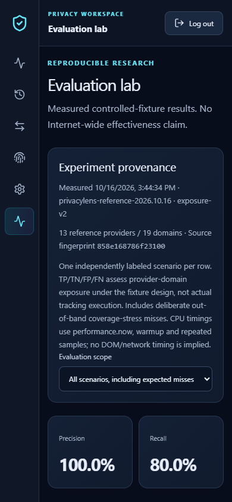
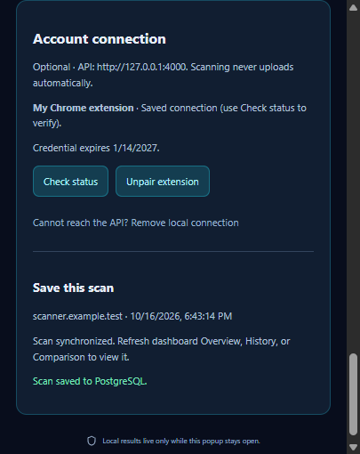
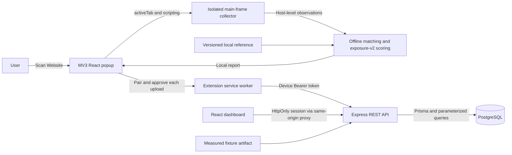

# PrivacyLens Pro

**Local-first website privacy intelligence with explainable scoring and consent-based synchronization.**

PrivacyLens Pro is a cybersecurity research/portfolio monorepo: a Chrome Manifest V3 extension observes website resource references, a TypeScript engine matches an offline provider registry, and an authenticated React dashboard analyzes only scans that a user explicitly approves for storage. Express and PostgreSQL provide real authentication, device pairing, owner-scoped history and analytics. Scanning works with the backend stopped.

**Status:** Phases 1–6 implemented; Phase 7 Part A prepares the source release, CI and deployment configuration. Locally verified, not publicly deployed. No hosted service, public repository or Chrome Web Store listing is claimed. [Release readiness and pending checks](docs/RELEASE_READINESS.md).

Phase 7 Part B adds [clean-snapshot publication preparation](docs/PUBLICATION_SNAPSHOT.md), stronger export/credential guards and portable documentation. The snapshot intentionally omits original Git history; optional historical Phase 5 performance reproduction still requires the private checkpoint. Source publishing and Git initialization remain subject to approval.

## Implemented features

- User-initiated DOM and Resource Timing scanning through `activeTab`/`scripting`; no automatic browsing collection.
- Offline, boundary-safe indexed matching: **13 providers / 19 domains**, source links, reviewed dates, five categories and dataset versioning.
- Animated privacy score, transparent capped deductions, coverage assessment, resource evidence and practical recommendations. Empty/unobservable snapshots withhold a score.
- Secure registration/login/logout, scrypt password hashing, HttpOnly session cookies, CSRF/origin checks and per-user authorization.
- One-time expiring pairing codes, hashed revocable device credentials, status/unpairing, explicit account consent plus approval of **each scan** before sanitized upload.
- PostgreSQL-backed Overview, Scan History, Website Comparison, Settings and Tracker Intelligence. New accounts display honest empty states; old scores are never silently recalculated.
- Evaluation lab with actual reproducible fixture outcomes, confusion counts, precision/recall/F1, latency, interactive charts, case filters and documented limitations.

## Interface

Actual Chrome captures from the isolated controlled-fixture workflow (2026-10-16), visually reviewed for secrets/personal data: mobile Evaluation lab and approved extension synchronization. These are test results, not personal browsing or a hosted service.





## Architecture



The local scan path has no API dependency. Pairing and approved uploads are separate actions. [Detailed architecture](docs/ARCHITECTURE.md) · [Database ER diagram](docs/DATABASE.md) · [REST contracts](docs/API.md).

| Layer          | Technology                                                                                     |
| -------------- | ---------------------------------------------------------------------------------------------- |
| Extension      | Manifest V3, Chrome APIs, React 19, TypeScript, Vite 8                                         |
| Dashboard      | React 19, Tailwind CSS 4, Recharts, lazy page modules                                          |
| Backend        | Node.js 24, Express 5, Zod, scrypt, Helmet, rate limits                                        |
| Data           | PostgreSQL 17, Prisma 7, pg adapter, additive SQL migrations                                   |
| Research/tests | tldts, independently labeled fixtures, Vitest, actual HTTP/PostgreSQL, native Chrome CDP       |
| Tooling        | npm workspaces/lockfile, ESLint, Prettier, GitHub Actions, prepared Docker/Caddy configuration |

## Quick start

Use Node **24.x**, npm **11+**, PostgreSQL **17** and installed Google Chrome. Run commands from this repository's `privacylens` root. See [complete developer setup](docs/SETUP.md) for Windows database creation, environment configuration and troubleshooting.

For local scanning only:

```powershell
npm ci
npm run build -w @privacylens/extension
npm run verify:extension
```

Open `chrome://extensions`, enable Developer mode, Load unpacked → `apps/extension/dist`. Open a normal HTTP(S) website and click **Scan Website**. Reload the extension after rebuilding. No account, API or database is required for scanning.

For the dashboard and optional synchronization, create **separate** application/test databases. Copy `.env.example` to `.env` only if it does not exist, and edit both database URLs privately. Never overwrite an existing environment or commit credentials.

```powershell
if (-not (Test-Path .env)) { Copy-Item .env.example .env }
# Configure DATABASE_URL and TEST_DATABASE_URL locally before continuing.
npm run db:check
npm run db:generate
npm run db:validate
npm run db:migrate
npm run db:migrate:test
npm run db:seed
npm run db:seed:test
npm run db:inspect
npm run build
npm run dev
```

Open **http://localhost:5173**. Register or use your existing account. Settings → intentionally enable storage → Connected Extensions → generate a one-time code. Enter it in the extension's Account connection panel. After scanning, select **Sync This Scan**, review exact metadata, tick the per-scan consent checkbox, and confirm. Refresh dashboard history/analytics. [Exact pairing and revocation steps](docs/PHASE5.md).

Seeds maintain reference providers only; no fabricated account/history is created. Migrations do not reset existing data. Test writes are restricted to an identity-verified separate database. API liveness: `http://127.0.0.1:4000/api/v1/health`; readiness: `/api/v1/ready` (503 if the database is unavailable).

## Research methodology and verified evidence

The current Phase 7 validation passed **160 unit tests, 59 real PostgreSQL integration tests and 19 native Chrome workflow checks**, including credential-origin isolation. TypeScript, lint, formatting, builds and packaging passed; npm reported zero known dependency vulnerabilities. [Executed results](docs/VALIDATION.md) distinguish local evidence from unexecuted remote CI/deployment checks. The Phase 6 baseline was 135/59/18.

The 29-case controlled evaluation reports **TP 16, FP 0, TN 9, FN 4**: precision **100%**, recall **80%**, F1 **88.89%**. Four deliberately out-of-band cases expose unlisted/CNAME/hidden/restricted evidence limitations. The observable subset is reported separately, not substituted for the full corpus. These are reproducible, independently labeled synthetic scenarios, **not estimates of Internet-wide accuracy or proof of actual tracking execution**.

Run `npm run evaluate` to reproduce engine measurements, review the JSON artifact, then rebuild/restart the API to update Evaluation lab. `npm run evaluate:check` checks source provenance. Actual latency samples, warmups, workloads, environment, negative findings and the rejected index experiment are retained in [research evaluation](docs/RESEARCH_EVALUATION.md), [performance](docs/PERFORMANCE.md), and [raw artifacts](docs/research/). Historical Phase 5 timing reproduction requires checkpoint `a97e5e0`.

```powershell
npm run security:repo
npm run release:check
npm audit
npm run typecheck
npm run lint
npm run format:check
npm test
npm run test:integration
npm run evaluate:check
npm run build
npm run test:smoke
npm run verify:extension
npm run test:browser-scanner
npm run test:browser-sync
```

Chrome checks exercise actual collection/action permissions, consent, worker upload, PostgreSQL provenance, dashboard results and revocation. Generated test screenshots/reports live in ignored `.browser-smoke/`; no invented screenshots are included here. [Five-minute technical demo](docs/DEMO.md).

## Privacy, security and limitations

The collector discards URL paths/queries/fragments and never reads cookies, form values, page text, request bodies or headers. Uploads contain only approved host-level findings, score/provenance, counts, protocol and timestamp. Hostnames/timestamps are still sensitive account data. No automatic sync, offline upload queue or server-side remote scanning exists.

Resource references are evidence of provider association, not proof of a request completing, personal data transmission, maliciousness or legal compliance. Coverage excludes DNS/CNAME resolution, opaque proxies, complete cross-frame/network activity and actions after the snapshot. Scores are transparent heuristics, not security certification. [Tracker sources/licenses](docs/TRACKER_INTELLIGENCE.md) · [Scoring methodology](docs/SCORING_METHODOLOGY.md) · [Security audit](docs/SECURITY_AUDIT.md).

Production still needs approved hosting/domain/database, verified HTTPS/TLS/proxy controls, backups/restore, monitoring, scheduled inactive-record cleanup, and recovery/verification/MFA decisions. Rate limits are in-process; multiple replicas need a shared store. [Deployment runbook](docs/DEPLOYMENT.md) prepares these boundaries. Production extension builds require an explicit HTTPS origin, use `dist-production`, and cannot silently target localhost. Containers/TLS and remote CI have not been executed locally; Docker/Caddy are unavailable on the development laptop.

## Repository and licensing

```text
apps/extension     MV3 popup, worker, collector, deterministic analysis
apps/web           Authenticated React dashboard
apps/api           Express API, Prisma schema/migrations/seed
packages/shared    Zod contracts, domain utilities, registry, methodology
fixtures           Controlled scanner and independently labeled research cases
scripts            Database guards, evaluation, browser checks, release checks
deploy             Container, reverse-proxy and managed-database preparation
docs               Setup, diagrams, research, security, demo and release evidence
```

Original application source/documentation: [MIT](LICENSE). Independent tracker reference: CC0-1.0; dependencies/vendor materials retain their own terms. [Third-party notices](THIRD_PARTY_NOTICES.md) · [Security reporting](SECURITY.md) · [Phase 7 release preparation](docs/PHASE7.md). Public publishing and deployment require the owner's explicit approval.
