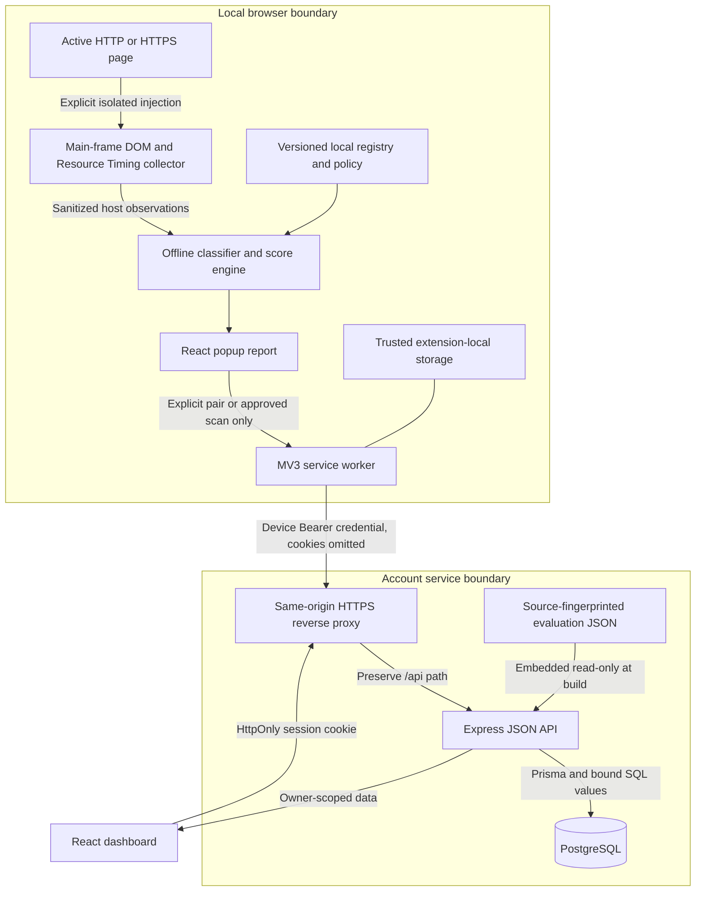

# Architecture and trust boundaries

Three independently built applications share TypeScript contracts, an offline reference registry and methodology. Vite builds extension/dashboard; esbuild bundles API application/shared source while runtime dependencies remain external. Node 24, installed runtime dependencies and generated Prisma client are required for the API. No external AI service or secret API key is used.

## Local scan flow

The popup queries the active tab and injects `collect.ts` using `activeTab`, `scripting`, isolated world and main-frame scope. It observes script/image/iframe references and resource timing; protocols/hostnames/kinds/source survive sanitization, while paths, query strings, fragments, content, cookies and headers do not. Bounds and document identity checks prevent unbounded/racing snapshots.

The engine groups observations, classifies public/private suffix site boundaries and uses an indexed DNS-label suffix registry. Deductions are deterministic, capped and deduplicated. Results remain in popup memory; closing it clears that report. The API/database can be stopped. There are no browsing listeners, automatic uploads or offline queue.

## Account and approved upload flow

Dashboard auth uses scrypt and random opaque HttpOnly cookies whose digests are stored in PostgreSQL. SameSite Strict and exact Origin/JSON/Fetch Metadata checks protect cookie writes. Authenticated routes derive ownership from the session, never user-supplied IDs. Credentialed fetches have timeouts, cancellation and Zod response validation; protected pages distinguish expired authentication from an unavailable server.

Settings generates a five-minute 128-bit single-use code, stored as a digest and claimed atomically. The worker redeems it for a scoped 256-bit device credential, retained only in trusted extension storage; only its digest is stored server-side. Codes do not log the dashboard into the extension. Device CORS is separate and noncredentialed; Bearer authentication is mandatory. A packaged-popup sender check prevents arbitrary content scripts invoking the worker.

Per-scan approval produces a fresh allowlisted payload. Both account storage consent and request `consent:true` are required. A device/preference row-locked transaction applies ownership/retention, stores normalized findings, and deduplicates `(deviceId,clientUploadId)`. Exact retries return the record; changed payloads get 409. Revoking a device prevents further uploads while preserving saved scans. Dashboard logout does not revoke devices.

## Data, research and presentation

Overview/history/comparison query actual retained owner records. `Scan.analysis` preserves optional methodology/dataset/coverage/components; legacy null provenance is displayed as unknown and never recalculated. Tracker Intelligence reads seeded database references and bounded owner evidence. Evaluation lab reads an actual independently labeled engine experiment from the authenticated API; it is an immutable build artifact, not live/random statistics. Regenerating it requires rebuilding/restarting the API.

Pages/charts and optional sync controls load lazily. Tables and collection remain bounded/scrollable. Stable shared schemas prevent UI/API contract drift. [DATABASE.md](DATABASE.md) gives relationships; [API.md](API.md) gives endpoints; [SCORING_METHODOLOGY.md](SCORING_METHODOLOGY.md) explains score interpretation.

## Development versus prepared production

Development: Vite proxies `/api` to loopback Express; local extension grant/CSP permits only 127.0.0.1. Production preparation: Caddy serves React and proxies `/api` to a non-published API container; managed PostgreSQL is external over verified TLS. Express bind address and proxy IP/CIDR trust are explicit. A separate HTTPS extension build derives worker target, narrow manifest grant and CSP from one validated public origin, writing `dist-production`. Saved credentials cannot be sent to a different API origin.

The production topology is prepared but not deployed or locally container-tested. No automatic migrations run at service startup. Migration tooling lives in a separate manually invoked image target. [DEPLOYMENT.md](DEPLOYMENT.md) documents operations, residual controls and acceptance gates.
