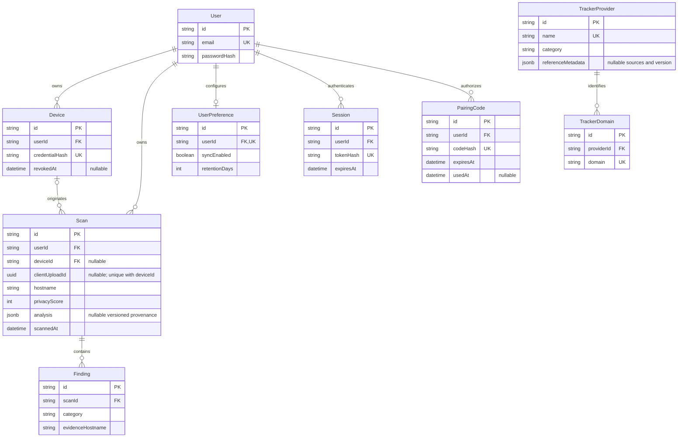

# PostgreSQL schema and data lifecycle

Prisma 7 reads its datasource URL from `apps/api/prisma.config.ts`; runtime uses `@prisma/adapter-pg`. Nine model tables and migration history are implemented. The diagram shows actual relationships and selected key fields; omitted timestamps/non-key fields remain defined in `apps/api/prisma/schema.prisma`.

## Migrations and constraints

| Migration                            | Additive behavior                                                               |
| ------------------------------------ | ------------------------------------------------------------------------------- |
| `20261016000100_foundation`          | Creates nine models, relationships, constraints and baseline indexes            |
| `20261016000200_auth_integrity`      | Enforces normalized email and session digest format                             |
| `20261016000300_device_sync`         | Nullable scan device/upload provenance, Device FK and unique device/upload pair |
| `20261016000400_analysis_provenance` | Nullable `Scan.analysis` and `TrackerProvider.referenceMetadata` JSONB          |

Actual local PostgreSQL 17.11 inspection verified **27 indexes including migration history, eight foreign keys and ten CHECK constraints** in each database. Checks cover score/count bounds, retention, known concern/transport/category/severity strings, normalized email and session digest format. Email, tracker domain, token/code/device digests are unique. Owner/date/hostname indexes support retained history. No extra performance index was adopted after the controlled experiment failed to justify it.

User deletion cascades through owned records; scan deletion cascades findings, provider deletion cascades reference domains. Device deletion sets the nullable Scan FK to null; ordinary revocation only timestamps the device and preserves scan history. New preferences disable synchronization and use 30-day retention. Reads exclude expired owner scans; writes/settings purge expired owner scans. Scheduled cleanup for inactive accounts/auth records remains deployment work.

The seed idempotently maintains **13 providers / 19 domains** and original reference provenance. It creates no user or scan fixtures. Optional analysis is a reported historical result, not a server-verified website measurement. Legacy null analysis remains unknown; no backfill/recalculation was performed. No full URLs, cookies, page content or headers are stored; hostname/timestamp metadata remains private account data.

## Local safety and production operations

`npm run db:check` and administrative wrappers verify both configured names and actual server/database identities. Application and test targets must be distinct before writes. Integration/browser/benchmark scripts write only uniquely identified test users in the test database, clean up their cascading records, and check read-only application row counts unchanged. No reset/truncate command is part of setup. Tests are not a substitute for least-privilege database permissions.

Runtime pools use at most ten connections per process, a three-second connection timeout and ten-second statement timeout. API repositories use Prisma predicates/bound SQL values and owner-scoped transactions; input never becomes a SQL identifier. Production should budget replica pools, configure verified TLS/CA, separate migration/runtime roles, back up before migrations and test restoration separately. Use direct migration URLs if a managed provider's transaction pooler cannot support migration tooling. [DEPLOYMENT.md](DEPLOYMENT.md) gives the prepared release flow.
